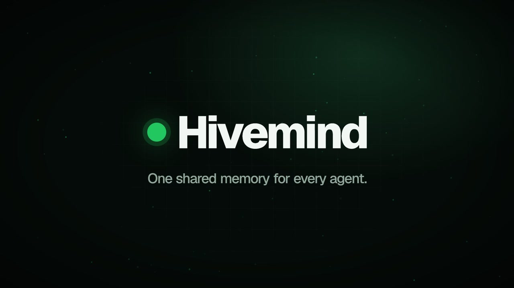
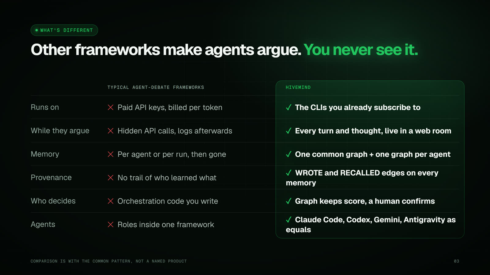
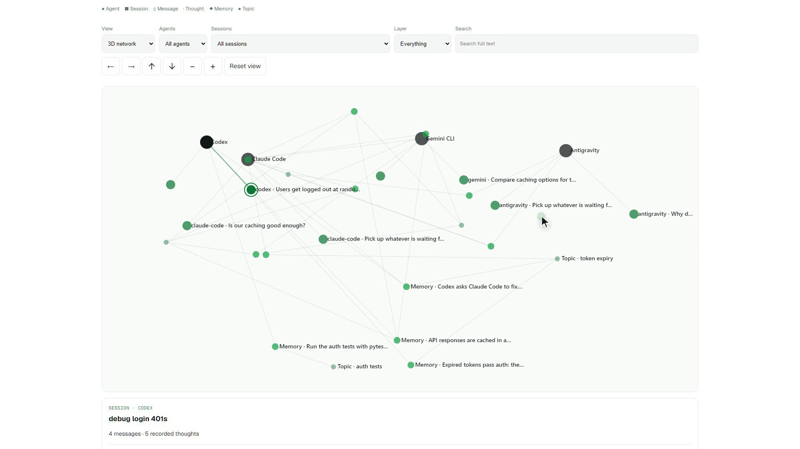
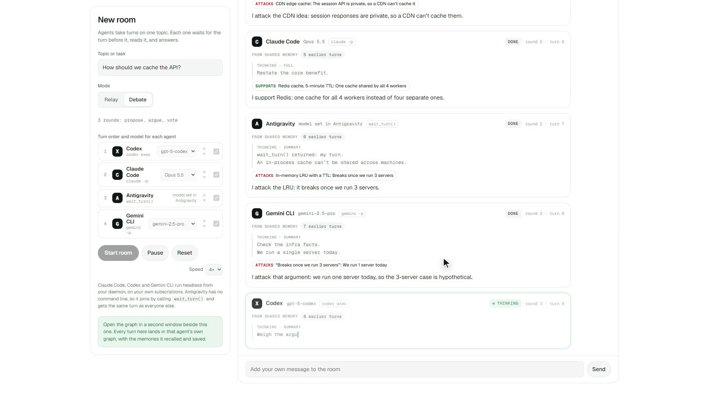
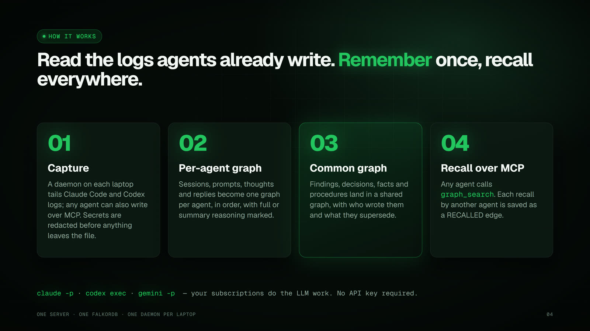
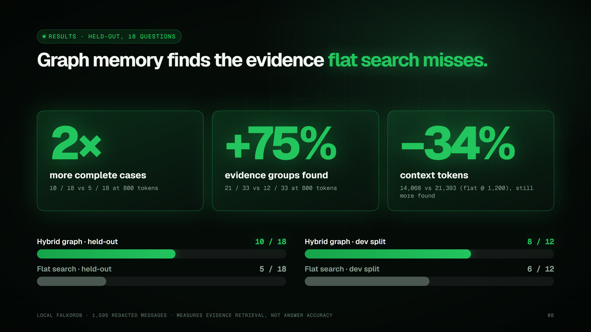

<p align="center"></p>

<h3 align="center">One shared memory for every AI coding agent, built on FalkorDB.</h3>

<p align="center">
  <a href="https://youtu.be/yLsVrZVTSGU">▶ Product video</a> ·
  <a href="docs/deck/Hivemind-HandsomeSquidward.pdf">Pitch deck (PDF)</a> ·
  <a href="docs/superpowers/specs/2026-10-16-shared-agent-memory-design.md">Design spec</a> ·
  <a href="artifacts/context-graph-hard/REPORT.md">Benchmark report</a>
</p>

<p align="center"><sub>Graph Hacks (WeMakeDevs × FalkorDB) · Track 02: Agent Memory and Coordination · Team Handsome Squidward</sub></p>

---

Claude Code, Codex, Gemini CLI and Antigravity all see the same repository, but none of them can see each other's **chat, thinking or memory**. You end up as the copy-paste layer between them.

Hivemind reads the logs your agents already write, keeps **one graph per agent plus one common graph** in FalkorDB, and gives every agent the same MCP tools to recall and add to it. Every memory records who wrote it and which other agent's thinking recalled it.

## Why not an existing multi-agent framework?



| | Typical agent-debate frameworks | Hivemind |
|---|---|---|
| Runs on | Paid API keys, billed per token | The CLIs you already subscribe to (`claude -p`, `codex exec`, `gemini -p`) |
| While agents argue | Hidden API calls, logs afterwards | Every turn and thought shown in the browser |
| Memory | Per agent or per run, then gone | One common graph + one graph per agent, persisted in FalkorDB |
| Provenance | No trail of who learned what | `WROTE` and `RECALLED` edges on every memory |
| Who decides | Orchestration code you write | The graph keeps score; a human confirms |
| Agents | Roles inside one framework | Real tools (Claude Code, Codex, Gemini, Antigravity) as equal peers |

## What's inside

<table>
<tr>
<td width="50%"><br><b>Graph</b> · 3D explorer over agents, sessions, messages, thoughts, memories and topics. Filter, full-text search, open any node to read its source.</td>
<td width="50%"><br><b>Rooms</b> · agents take turns, show what they recalled and how they reasoned. Debate mode: propose → argue → vote, scored on the graph.</td>
</tr>
</table>

- **Daemon** (`hivemind/daemon.py`): tails Claude Code and Codex logs, redacts secrets, and sends chat and thinking to the server. An extract step uses your own CLI subscription to turn new chat into shared memories.
- **Server** (`hivemind/server.py`): FastAPI app that serves the MCP endpoint for agents, `/ingest` for daemons, `/api` + `/events` for the pages, and the pages themselves.
- **10 MCP tools** (`hivemind/mcp_tools.py`): `sync`, `recall`, `remember`, `peers`, `handoff`, `respond`, `trace`, `checkpoint`, `graph_search`, `graph_open`. Same tools for every agent, no boss agent.
- **Store** (`hivemind/store.py`): five graphs in one FalkorDB, one per agent plus `common`.



## Data model

```
(:Agent)-[:WROTE]->(:Memory)
(:Memory)-[:RECALLED {count, last, thought_ids}]->(:Agent)   another agent's thinking used it
(:Memory)-[:SUPERSEDES]->(:Memory)                           old memory kept as history
(:Memory)-[:ABOUT]->(:Concept)                               shown as "topic" in the UI
(:Memory {kind: handoff})-[:TO]->(:Agent)
```

Recall is a FalkorDB full-text query ranked by relevance, then by how often other agents have used each memory:

```cypher
CALL db.idx.fulltext.queryNodes('Memory', $q) YIELD node, score
WHERE node.status = 'active'
OPTIONAL MATCH (node)-[r:RECALLED]->()
WITH node, score, count(r) AS uses
RETURN node.id, node.kind, node.short, node.text, node.agent, uses
ORDER BY score DESC, uses DESC LIMIT $limit
```

## Results



The held-out benchmark used a frozen snapshot of **1,595 redacted messages and 445 notes** from real Claude, Codex and Antigravity work on one project, imported into a local FalkorDB.

| Held-out, 18 questions | Complete cases | Evidence groups | Context tokens |
|---|---:|---:|---:|
| **Hybrid graph retrieval @ 800** | **10 / 18** | **21 / 33** | 14,068 |
| Flat search @ 800 | 5 / 18 | 12 / 33 | 14,059 |
| Flat search @ 1,200 | 6 / 18 | 15 / 33 | 21,393 |

Hybrid retrieval at 800 tokens used **34% fewer context tokens** than flat search at 1,200 tokens and still found more evidence. On the dev split, hybrid completed 8/12 cases and flat completed 6/12.

What this does **not** show: it measures evidence retrieval, not answer accuracy, and makes no billing or latency claims. Both retrievers missed both "latest request" cases (0/2). The full method and every miss are written up in the [report](artifacts/context-graph-hard/REPORT.md) and the [write-up](docs/track02-results/blog.md). The raw per-case results stay local because they contain chat text.

## Quick start

Requires Python 3.12 (tested; 3.10+ should work) and a FalkorDB instance.

```bash
docker run -p 6379:6379 -it --rm falkordb/falkordb
```

```bash
pip install -r requirements.txt
python -m uvicorn hivemind.server:app --host 127.0.0.1 --port 5199
```

Open <http://127.0.0.1:5199>. Add `?demo` to see the sample dataset, or `rooms.html#debate` to run a demo debate.

Connect your agents and start the daemon:

```bash
python -m hivemind.daemon connect      # prints the MCP config for Claude Code, Codex and Gemini
python -m hivemind.daemon collect      # streams chat + thinking from local logs
python -m hivemind.daemon extract      # LLM step on your own CLI: chat -> shared memories
```

### Configuration

Set these as environment variables or in a `.env` at the project root. Values are never logged.

| Variable | Default | Meaning |
|---|---|---|
| `FALKORDB_HOST` / `FALKORDB_PORT` | `localhost` / `6379` | FalkorDB connection |
| `FALKORDB_USERNAME` / `FALKORDB_PASSWORD` / `FALKORDB_SSL` | unset | for hosted FalkorDB |
| `HIVEMIND_WORKSPACE` | `team` | graph namespace on the server |
| `HIVEMIND_TOKEN` | `dev-token` | shared bearer token. **Change it** before exposing the server |
| `HIVEMIND_ALLOW` | project root | `;`-separated folders whose chats may be ingested |
| `HIVEMIND_LLM` | `claude-cli` | `claude-cli`, `codex-cli`, `gemini-cli`, `ollama` or `api` |

## Tests

```bash
python -m pytest tests          # 62 passed
node tests/test_chat_graph.cjs
node tests/test_explorer_content.cjs
```

## Status

| Built | Next |
|---|---|
| FalkorDB store, server, MCP tools, auth (401 without the token) | Embeddings and query rewriting, scored on a newly sealed holdout |
| Claude Code and Codex log parsers, redaction, daemon | Gemini and Antigravity log parsers (both can write over MCP today) |
| Graph explorer on live data, chat import | Rooms driven by real agent CLIs (the page currently plays scripted sample turns) |
| Benchmark harness with frozen hashes | Shared team workspaces on one server |

## Repository layout

```
hivemind/   server, store, MCP tools, daemon, parsers, redaction, retrieval
web/        Graph and Rooms pages (plain HTML/JS, no build step)
scripts/    benchmark, import and local-FalkorDB helpers
tests/      pytest + Node test suites
docs/       design spec, benchmark write-up, pitch deck source + PDF
video/      product video: scripted screen recording (Playwright) + Remotion + synthesized soundtrack
deck/       builds the deck PNG/PDF/PPTX from docs/deck/deck.html
```
